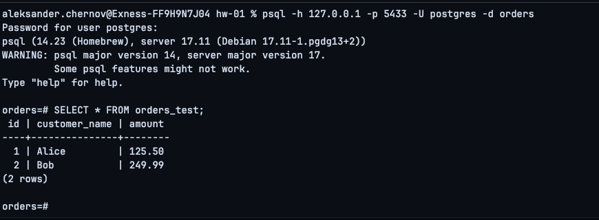
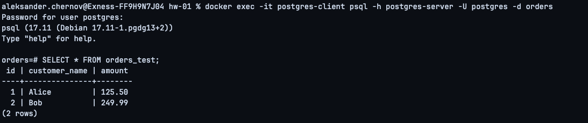
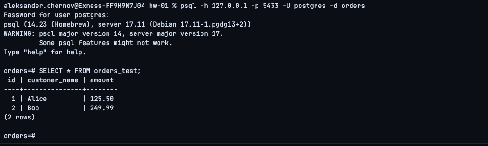

# Домашнее задание №1 — PostgreSQL в Docker

## Цель

Развернуть PostgreSQL в Docker с внешним подключением и устойчивым хранением данных, чтобы после удаления и повторного создания контейнера данные базы сохранялись.

> Стенд выполнялся на macOS с Docker Desktop. В исходном задании указан Ubuntu-хост; на macOS Docker Desktop запускает Linux-контейнеры внутри своей виртуальной среды. Из-за особенностей macOS/Docker Desktop потребовались два изменения относительно исходного примера: каталог данных был перенесён в домашнюю директорию, а внешний порт PostgreSQL изменён с `5432` на `5433`.

## 1. Подготовка Docker

Для работы использовался Docker Desktop на macOS. Проверка Docker выполнялась командами:

```bash
docker --version
docker compose version
```

Рабочий каталог задания:

```bash
mkdir -p ~/postgres-hw/hw01
cd ~/postgres-hw/hw01
```

## 2. Каталог для постоянного хранения данных

Изначально по заданию был создан системный каталог `/var/lib/postgresql`, однако PostgreSQL не смог инициализировать в нём кластер из-за ограничений прав Docker Desktop на macOS:

```text
chmod: changing permissions of '/var/lib/postgresql/data': Operation not permitted
initdb: error: could not change permissions of directory "/var/lib/postgresql/data": Operation not permitted
```

Поэтому для bind mount был использован каталог в домашней директории пользователя:

```bash
mkdir -p ~/postgres-data
```

Он монтируется в стандартный каталог данных PostgreSQL внутри контейнера:

```text
${HOME}/postgres-data:/var/lib/postgresql/data
```

Таким образом, данные физически находятся вне файловой системы контейнера и сохраняются после его удаления.

## 3. Docker Compose

Использовался следующий `docker-compose.yml`:

```yaml
services:
  postgres:
    image: postgres:17
    container_name: postgres-server
    environment:
      POSTGRES_DB: orders
      POSTGRES_USER: postgres
      POSTGRES_PASSWORD: postgres
    ports:
      - "5433:5432"
    volumes:
      - ${HOME}/postgres-data:/var/lib/postgresql/data
    networks:
      - postgres-net

  psql:
    image: postgres:17
    container_name: postgres-client
    entrypoint: ["sleep", "infinity"]
    networks:
      - postgres-net

networks:
  postgres-net:
    driver: bridge
```

Контейнеры запускались командой:

```bash
docker compose up -d
```

Проверка:

```bash
docker compose ps
```

## 4. Подключение из контейнера-клиента

Для проверки сетевого взаимодействия внутри Docker был запущен отдельный контейнер `postgres-client` с клиентом `psql`.

Подключение к серверу PostgreSQL:

```bash
docker exec -it postgres-client psql -h postgres-server -U postgres -d orders
```

В базе была создана таблица:

```sql
CREATE TABLE orders_test (
    id SERIAL PRIMARY KEY,
    customer_name VARCHAR(100) NOT NULL,
    amount NUMERIC(10,2) NOT NULL
);
```

Добавлены две строки:

```sql
INSERT INTO orders_test (customer_name, amount)
VALUES
    ('Alice', 125.50),
    ('Bob', 249.99);
```

Проверка:

```sql
SELECT * FROM orders_test;
```

Результат:

```text
 id | customer_name | amount
----+---------------+--------
  1 | Alice         | 125.50
  2 | Bob           | 249.99
(2 rows)
```


## 5. Внешнее подключение с macOS

На macOS уже был запущен локальный PostgreSQL 14 из Homebrew, использующий порт `5432`:

```text
PostgreSQL 14.23 (Homebrew)
data_directory = /opt/homebrew/var/postgresql@14
```

Поэтому внешний порт Docker-контейнера был изменён на `5433`, при этом PostgreSQL внутри контейнера продолжает слушать стандартный порт `5432`.

Проброс порта в Compose:

```yaml
ports:
  - "5433:5432"
```

Подключение с macOS к PostgreSQL в Docker:

```bash
psql -h 127.0.0.1 -p 5433 -U postgres -d orders
```

Проверка:

```sql
SELECT * FROM orders_test;
```

Результат содержит обе ранее созданные строки:

```text
 id | customer_name | amount
----+---------------+--------
  1 | Alice         | 125.50
  2 | Bob           | 249.99
(2 rows)
```



Клиент `psql` на macOS имеет версию 14, а сервер в Docker — PostgreSQL 17, поэтому `psql` выводит предупреждение о несовпадении major-версий. Для использованных в задании базовых SQL-команд это не помешало работе.

## 6. Удаление серверного контейнера

Серверный контейнер был остановлен и удалён:

```bash
docker stop postgres-server
docker rm postgres-server
```

После удаления выполнена проверка:

```bash
docker ps -a
```

В списке отсутствует `postgres-server`, при этом `postgres-client` продолжает работать.


Каталог `~/postgres-data` при этом не удаляется, так как находится на хосте и подключается к контейнеру через bind mount.

## 7. Повторное создание PostgreSQL

Сервер был создан заново из того же `docker-compose.yml`:

```bash
docker compose up -d postgres
```

Проверка готовности сервера:

```bash
docker exec postgres-server pg_isready -U postgres -d orders
```

После запуска выполнено повторное подключение из клиентского контейнера:

```bash
docker exec -it postgres-client psql -h postgres-server -U postgres -d orders
```

Проверка сохранности данных:

```sql
SELECT * FROM orders_test;
```

Результат:

```text
 id | customer_name | amount
----+---------------+--------
  1 | Alice         | 125.50
  2 | Bob           | 249.99
(2 rows)
```



Это подтверждает, что данные не были привязаны к жизненному циклу контейнера и сохранились в каталоге на хосте.

## 8. Повторная внешняя проверка

После пересоздания контейнера выполнено повторное подключение с macOS:

```bash
psql -h 127.0.0.1 -p 5433 -U postgres -d orders
```

Запрос:

```sql
SELECT * FROM orders_test;
```

Результат снова содержит обе строки:

```text
 id | customer_name | amount
----+---------------+--------
  1 | Alice         | 125.50
  2 | Bob           | 249.99
(2 rows)
```



## Проблемы и решения

### Ошибка прав при использовании `/var/lib/postgresql`

При попытке использовать системный каталог macOS PostgreSQL завершался с ошибкой:

```text
chmod: changing permissions of '/var/lib/postgresql/data': Operation not permitted
initdb: error: could not change permissions of directory "/var/lib/postgresql/data": Operation not permitted
```

Причина — особенности доступа Docker Desktop к файловой системе macOS. В качестве решения был создан каталог `~/postgres-data`, который был смонтирован в `/var/lib/postgresql/data` контейнера.

### Конфликт порта `5432`

На хосте уже работал PostgreSQL 14, установленный через Homebrew. Проверка показала:

```text
PostgreSQL 14.23 (Homebrew)
data_directory = /opt/homebrew/var/postgresql@14
```

Чтобы не останавливать существующий локальный PostgreSQL, внешний порт Docker был изменён на `5433`:

```text
host 5433 -> container 5432
```

Внутри Docker-сети контейнер-клиент по-прежнему подключается к `postgres-server:5432`.

## Итог

В ходе работы:

- PostgreSQL 17 был развёрнут в Docker;
- создан отдельный контейнер с клиентом `psql`;
- сервер и клиент подключены к общей Docker-сети;
- создана таблица `orders_test` и добавлены две строки;
- проверено подключение из контейнера-клиента;
- проверено внешнее подключение с macOS через опубликованный порт `5433`;
- серверный контейнер был остановлен и удалён;
- PostgreSQL был создан заново с тем же bind mount;
- после пересоздания таблица и обе строки сохранились;
- повторно подтверждено подключение как из Docker-сети, так и с хоста.

Таким образом, устойчивое хранение данных и воспроизводимость PostgreSQL-стенда подтверждены.
