# HW02 — Перенос каталога данных PostgreSQL на дополнительный диск

## Цель

Перенести каталог данных PostgreSQL на отдельный виртуальный диск, настроить его автомонтирование после перезагрузки и восстановить работоспособность кластера с новым `data_directory`.

Дополнительно выполнено задание со звёздочкой: тот же диск с данными PostgreSQL был подключён ко второй виртуальной машине, после чего кластер был запущен на новой VM с сохранением тестовой таблицы и строк.

> Примечание: стенд был развёрнут в UTM на macOS. Фактически использовалась Ubuntu 26.04.1 LTS ARM64 и PostgreSQL 18.6. По условию задания требовалась Ubuntu 22.04/24.04 LTS, поэтому версия ОС отличается от формулировки задания. Сама процедура переноса каталога данных, настройки `fstab` и запуска PostgreSQL выполнялась стандартными средствами Ubuntu/PostgreSQL.

## 1. Создание виртуальной машины

В UTM была создана виртуальная машина ARM64 с 4 GB RAM и системным диском 30 GB. Был установлен Ubuntu Server и OpenSSH Server.

Проверка:

```bash
lsb_release -a
lsblk
df -h
hostname -I
```

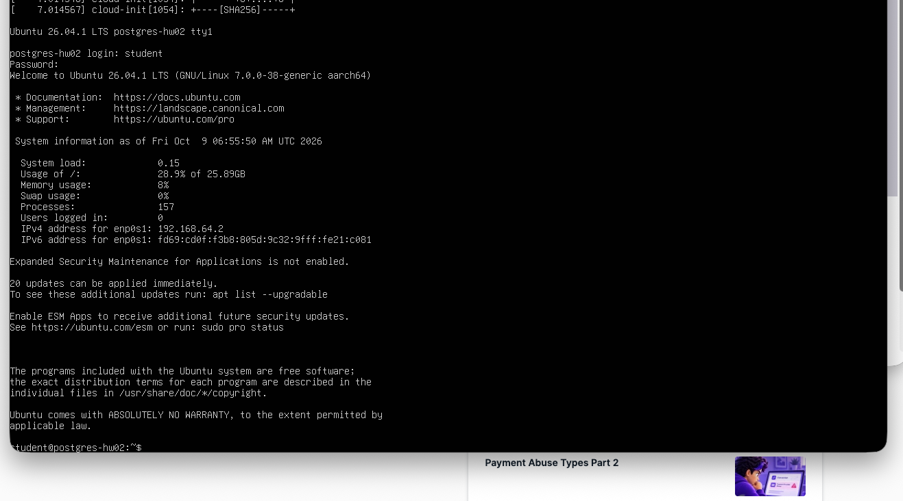

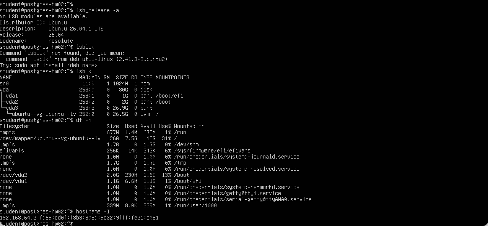

## 2. Подключение дополнительного диска

К первой VM был добавлен отдельный виртуальный диск размером 10 GB. После запуска:

```bash
lsblk
```

появился новый диск `vdb` размером 10 GB.

На нём был создан раздел:

```bash
sudo fdisk /dev/vdb
```

В `fdisk` был создан primary partition на весь диск, затем изменения записаны командой `w`.

## 3. Создание файловой системы и монтирование

```bash
sudo mkfs.ext4 /dev/vdb1
sudo mkdir -p /mnt/data
sudo mount /dev/vdb1 /mnt/data
```

Проверка:

```bash
df -h /mnt/data
lsblk -f
```

Результат:

```text
Filesystem      Size  Used Avail Use% Mounted on
/dev/vdb1       9.8G  2.1M  9.3G   1% /mnt/data
```

UUID раздела:

```text
004dd616-ae2f-412b-9e98-d8cbdc02056c
```

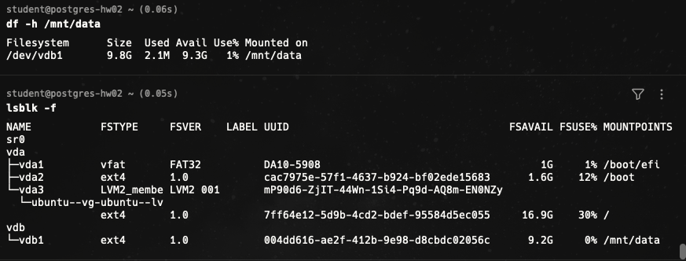

## 4. Настройка автомонтирования

В `/etc/fstab` добавлена строка:

```text
UUID=004dd616-ae2f-412b-9e98-d8cbdc02056c /mnt/data ext4 defaults 0 2
```

После изменения:

```bash
sudo systemctl daemon-reload
sudo mount -a
df -h /mnt/data
```

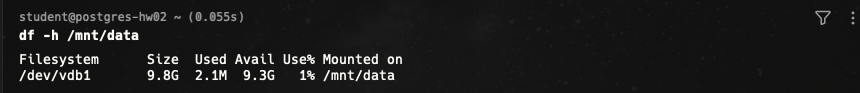

После перезагрузки диск также автоматически монтировался в `/mnt/data`.

## 5. Установка PostgreSQL

```bash
sudo apt update
sudo apt install postgresql postgresql-contrib -y
```

Проверка:

```bash
pg_lsclusters
psql --version
```

Результат:

```text
Ver Cluster Port Status Owner    Data directory              Log file
18  main    5432 online postgres /var/lib/postgresql/18/main /var/log/postgresql/postgresql-18-main.log
```

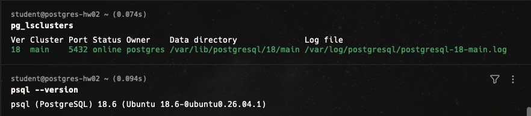

## 6. Создание тестовой таблицы

```bash
sudo -iu postgres
psql
```

```sql
CREATE TABLE test (
    id SERIAL PRIMARY KEY,
    name TEXT NOT NULL
);

INSERT INTO test (name)
VALUES ('Alice'), ('Bob');

SELECT * FROM test;
```

Результат:

```text
 id | name
----+-------
  1 | Alice
  2 | Bob
(2 rows)
```

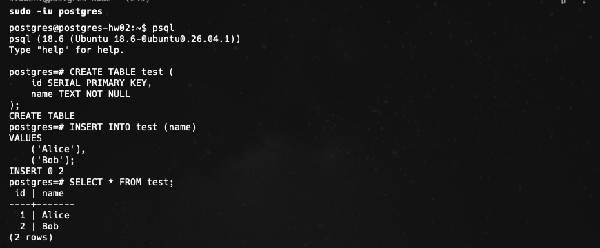

## 7. Исходный data_directory

```bash
grep -n "^[[:space:]]*data_directory" /etc/postgresql/18/main/postgresql.conf
```

Результат:

```text
42:data_directory = '/var/lib/postgresql/18/main'
```

## 8. Остановка кластера

```bash
sudo pg_ctlcluster 18 main stop
pg_lsclusters
```

Результат: кластер `18 main` перешёл в статус `down`.

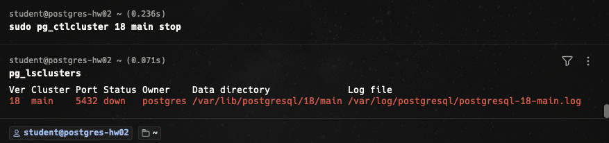

## 9. Подготовка нового каталога и перенос данных

```bash
sudo chown postgres:postgres /mnt/data
sudo mkdir -p /mnt/data/postgresql/18/main
sudo chown -R postgres:postgres /mnt/data/postgresql
sudo chmod 700 /mnt/data/postgresql/18/main
```

Перенос:

```bash
sudo rsync -aHAX /var/lib/postgresql/18/main/ /mnt/data/postgresql/18/main/
```

Проверка:

```bash
sudo du -sh /var/lib/postgresql/18/main
sudo du -sh /mnt/data/postgresql/18/main
sudo stat -c '%U:%G %a %n' /mnt/data/postgresql/18/main
```

Результат:

```text
40M /var/lib/postgresql/18/main
40M /mnt/data/postgresql/18/main
postgres:postgres 700 /mnt/data/postgresql/18/main
```

## 10. Ошибка запуска до изменения конфигурации

Старый каталог был безопасно переименован:

```bash
sudo mv /var/lib/postgresql/18/main /var/lib/postgresql/18/main.old
```

После попытки запуска:

```bash
sudo pg_ctlcluster 18 main start
```

получена ожидаемая ошибка:

```text
Error: /var/lib/postgresql/18/main is not accessible or does not exist
```

Причина: данные уже находились на новом диске, но `postgresql.conf` всё ещё указывал на старый `data_directory`.

## 11. Изменение data_directory

До:

```text
data_directory = '/var/lib/postgresql/18/main'
```

После:

```text
data_directory = '/mnt/data/postgresql/18/main'
```

Проверка:

```bash
grep -n "^[[:space:]]*data_directory" /etc/postgresql/18/main/postgresql.conf
```

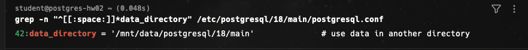

## 12. Запуск PostgreSQL с новым каталогом

```bash
sudo pg_ctlcluster 18 main start
pg_lsclusters
sudo -u postgres psql -c "SHOW data_directory;"
sudo -u postgres psql -c "SELECT * FROM test;"
```

Результат:

```text
18  main  5432  online  postgres  /mnt/data/postgresql/18/main
```

```text
/mnt/data/postgresql/18/main
```

```text
 id | name
----+-------
  1 | Alice
  2 | Bob
(2 rows)
```

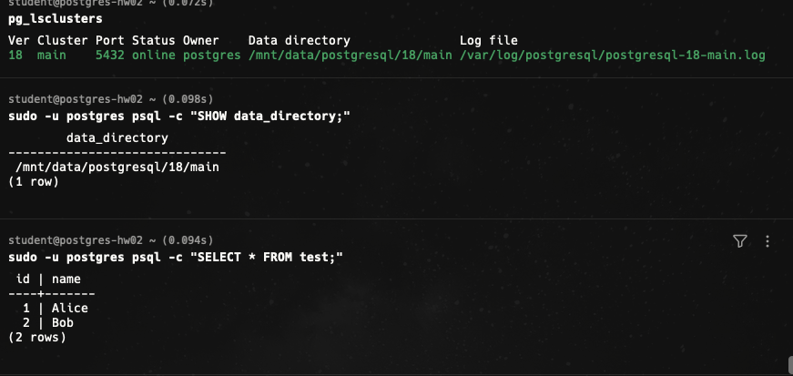

## 13. Проверка после перезагрузки

После reboot:

```bash
df -h /mnt/data
pg_lsclusters
sudo -u postgres psql -c "SHOW data_directory;"
sudo -u postgres psql -c "SELECT * FROM test;"
```

Подтверждено:
- `/dev/vdb1` автоматически смонтирован в `/mnt/data`;
- кластер `online`;
- PostgreSQL использует `/mnt/data/postgresql/18/main`;
- Alice и Bob сохранились.

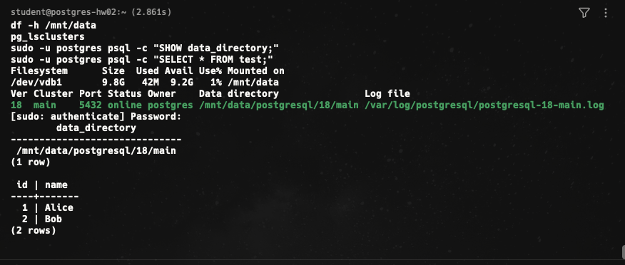

# Задание со звёздочкой — перенос диска на новую VM

## 14. Подготовка второй VM

В UTM была создана вторая VM. На неё установлен Ubuntu Server и PostgreSQL 18 той же major-версии.

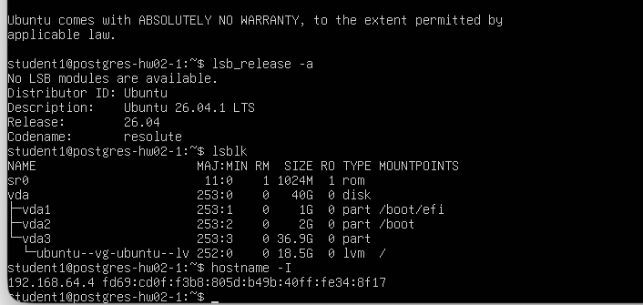

Локальный пустой кластер был остановлен:

```bash
sudo pg_ctlcluster 18 main stop
```

## 15. Подключение диска с первой VM

Ко второй VM был подключён тот же виртуальный диск:

```text
494BD56E-9324-4CC5-8B3C-D93C5A5606D8.qcow2
```

как VirtIO.

После запуска:

```bash
lsblk
lsblk -f
```

появился:

```text
vdb
└─vdb1
```

с тем же UUID:

```text
004dd616-ae2f-412b-9e98-d8cbdc02056c
```

Монтирование:

```bash
sudo mkdir -p /mnt/data
sudo mount /dev/vdb1 /mnt/data
```

Проверка:

```bash
sudo ls -la /mnt/data/postgresql/18/main | head
sudo cat /mnt/data/postgresql/18/main/PG_VERSION
```

`PG_VERSION` показал:

```text
18
```

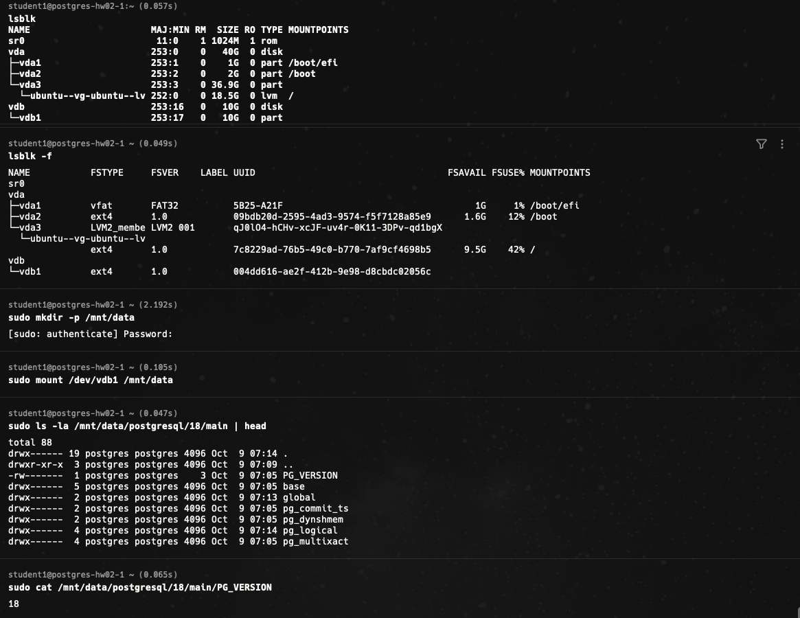

## 16. Настройка PostgreSQL на второй VM

В `/etc/fstab` второй VM добавлена строка:

```text
UUID=004dd616-ae2f-412b-9e98-d8cbdc02056c /mnt/data ext4 defaults 0 2
```

В `/etc/postgresql/18/main/postgresql.conf` изменено:

```text
data_directory = '/var/lib/postgresql/18/main'
```

на:

```text
data_directory = '/mnt/data/postgresql/18/main'
```

Запуск:

```bash
sudo pg_ctlcluster 18 main start
pg_lsclusters
sudo -u postgres psql -c "SELECT * FROM test;"
```

Результат:

```text
18  main  5432  online  postgres  /mnt/data/postgresql/18/main
```

```text
 id | name
----+-------
  1 | Alice
  2 | Bob
(2 rows)
```

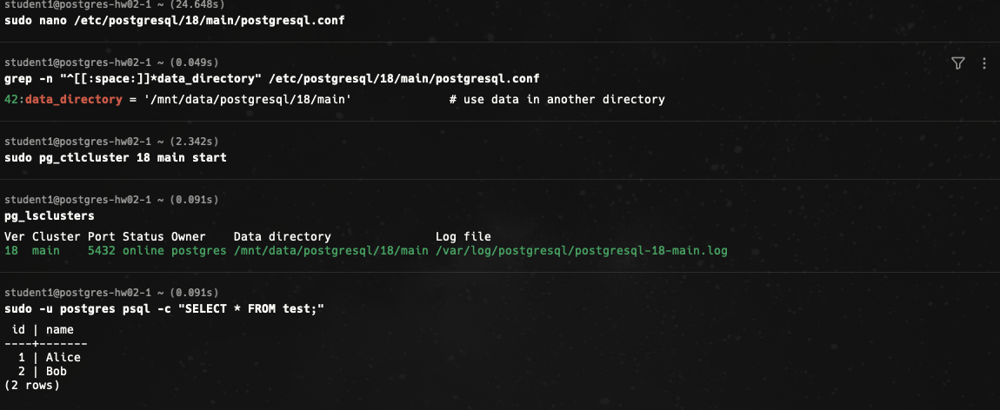

## Итог

В основной части каталог данных PostgreSQL был успешно перенесён с системного диска на отдельный 10 GB диск, автомонтирование настроено через `fstab`, кластер восстановлен после изменения `data_directory`, а тестовые данные сохранились.

В задании со звёздочкой тот же диск был подключён ко второй VM. PostgreSQL 18 на новой машине был настроен на этот каталог данных и успешно запустился с исходной таблицей `test` и строками Alice/Bob.
