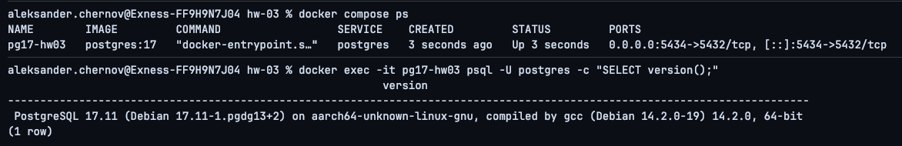
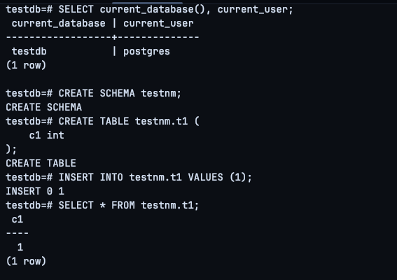
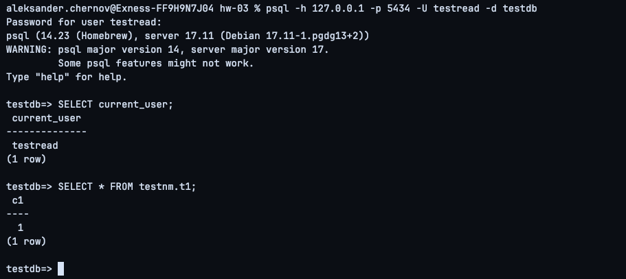
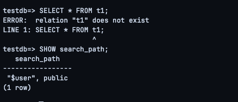
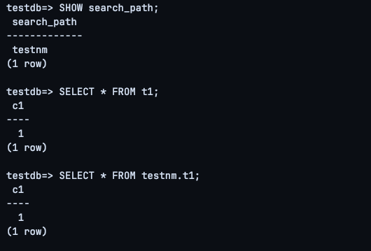
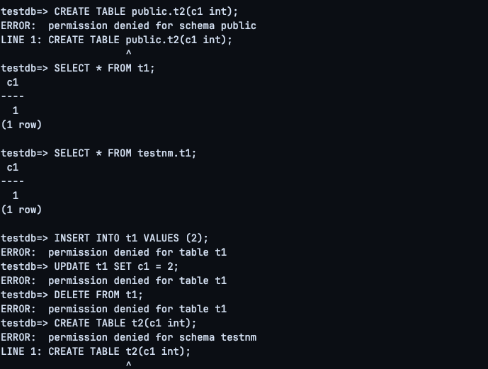
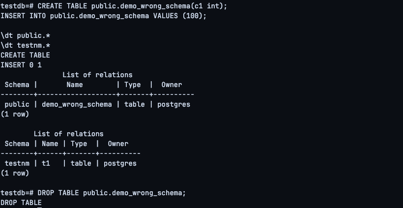

# HW03 — Роль readonly, схемы и search_path в PostgreSQL

## Цель

Настроить роль только для чтения в отдельной схеме PostgreSQL, проверить доступ к данным, запретить создание и изменение объектов и сделать обращение к таблицам без явного указания схемы предсказуемым через `search_path`.

Стенд развёрнут в Docker на macOS.

## 1. PostgreSQL 17 в Docker

`docker-compose.yml`:

```yaml
services:
  postgres:
    image: postgres:17
    container_name: pg17-hw03
    environment:
      POSTGRES_PASSWORD: postgres
    ports:
      - "5434:5432"
```

Запуск и проверка:

```bash
docker compose up -d
docker compose ps
docker exec -it pg17-hw03 psql -U postgres -c "SELECT version();"
```

Результат: PostgreSQL 17.11.



## 2. База, схема и таблица

Создана база:

```sql
CREATE DATABASE testdb;
```

После подключения к `testdb`:

```sql
CREATE SCHEMA testnm;

CREATE TABLE testnm.t1 (
    c1 int
);

INSERT INTO testnm.t1 VALUES (1);

SELECT * FROM testnm.t1;
```

Результат:

```text
 c1
----
  1
(1 row)
```



## 3. Роль readonly

Создана групповая роль:

```sql
CREATE ROLE readonly NOLOGIN;
```

Выданы права:

```sql
GRANT CONNECT ON DATABASE testdb TO readonly;
GRANT USAGE ON SCHEMA testnm TO readonly;
GRANT SELECT ON ALL TABLES IN SCHEMA testnm TO readonly;
```

Для будущих таблиц:

```sql
ALTER DEFAULT PRIVILEGES IN SCHEMA testnm
GRANT SELECT ON TABLES TO readonly;
```

Смысл прав:
- `CONNECT` — право подключиться к базе;
- `USAGE` — право обращаться к объектам схемы;
- `SELECT` — право читать таблицы.

## 4. Пользователь testread

Создан пользователь:

```sql
CREATE USER testread WITH PASSWORD 'test123';
GRANT readonly TO testread;
```

Подключение:

```bash
psql -h 127.0.0.1 -p 5434 -U testread -d testdb
```

Проверка:

```sql
SELECT current_user;
SELECT * FROM testnm.t1;
```

Чтение с явным указанием схемы работает.



## 5. Проблема с SELECT * FROM t1

Под `testread`:

```sql
SELECT * FROM t1;
```

Результат:

```text
ERROR: relation "t1" does not exist
```

Проверка:

```sql
SHOW search_path;
```

Результат:

```text
"$user", public
```

Схемы `testnm` в `search_path` нет, поэтому PostgreSQL не находит `t1` без указания схемы.



## 6. Настройка search_path

Под `postgres` выполнено:

```sql
ALTER ROLE testread IN DATABASE testdb
SET search_path = testnm;
```

После повторного подключения:

```sql
SHOW search_path;
SELECT * FROM t1;
SELECT * FROM testnm.t1;
```

Результат: `search_path = testnm`, обе формы `SELECT` успешно возвращают строку `1`.



## 7. Проверка readonly-ограничений

Под `testread` проверены операции изменения данных:

```sql
INSERT INTO t1 VALUES (2);
UPDATE t1 SET c1 = 2;
DELETE FROM t1;
```

Все завершились ошибкой:

```text
ERROR: permission denied for table t1
```

Попытка создать таблицу в `testnm`:

```sql
CREATE TABLE t2(c1 int);
```

Результат:

```text
ERROR: permission denied for schema testnm
```

Дополнительно запрещено создание объектов в `public`:

```sql
REVOKE CREATE ON SCHEMA public FROM PUBLIC;
REVOKE CREATE ON SCHEMA testnm FROM readonly;
```

После этого:

```sql
CREATE TABLE public.t2(c1 int);
```

также завершилась ошибкой доступа.

При этом чтение продолжило работать:

```sql
SELECT * FROM t1;
SELECT * FROM testnm.t1;
```



## 8. Демонстрация разных схем

Для демонстрации создана временная таблица в `public`:

```sql
CREATE TABLE public.demo_wrong_schema(c1 int);
INSERT INTO public.demo_wrong_schema VALUES (100);
```

Проверка:

```sql
\dt public.*
\dt testnm.*
```

показала, что объекты находятся в разных схемах:

```text
public | demo_wrong_schema
testnm | t1
```

После проверки таблица удалена:

```sql
DROP TABLE public.demo_wrong_schema;
```



Этот пример показывает, почему важно либо использовать квалифицированные имена (`testnm.t1`), либо явно настраивать `search_path`.

## Итог

В результате:
- запущен PostgreSQL 17;
- создана база `testdb`;
- создана схема `testnm`;
- создана таблица `testnm.t1`;
- роль `readonly` получила доступ только на чтение;
- пользователь `testread` успешно читает данные;
- без настройки `search_path` обращение к `t1` не работало;
- после `search_path = testnm` обращение к `t1` стало предсказуемым;
- `INSERT`, `UPDATE`, `DELETE` и `CREATE TABLE` запрещены;
- отдельно продемонстрирована проблема объектов в разных схемах.
