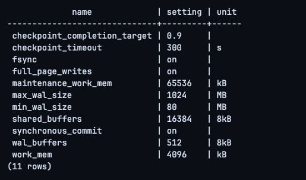
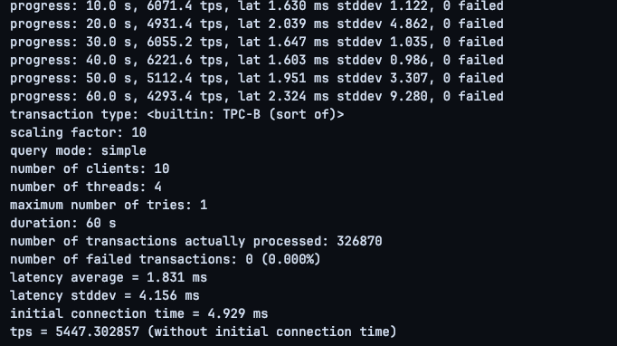
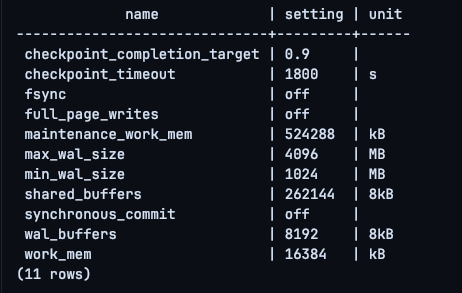
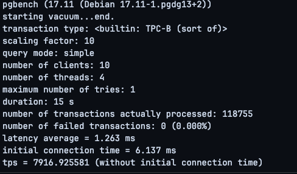
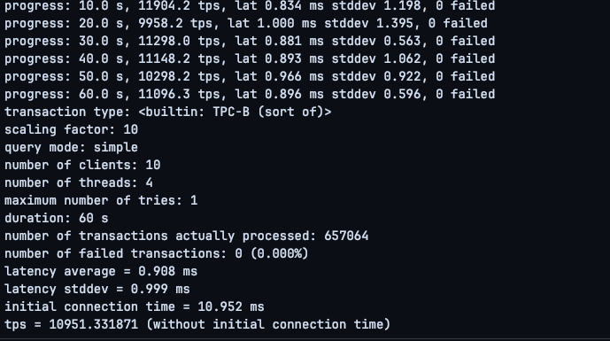

# HW04 — Pgbench: базовый тюнинг PostgreSQL

## Цель

Оценить эффект базового тюнинга PostgreSQL на тестовом стенде по схеме:

**baseline → изменение параметров → повторный тест → сравнение → вывод**

Стенд был развёрнут в Docker на macOS. Использовался PostgreSQL 17.11.

---

## 1. Условия стенда

Ресурсы, доступные контейнеру:

```text
RAM: 7.7 GiB
CPU: 8
Swap: 1 GiB
```

Для теста использовалась отдельная база `pgbenchdb`.

Инициализация:

```bash
docker exec pg17-hw03 pgbench -U postgres -i -s 10 pgbenchdb
```

Параметры обоих основных прогонов были одинаковыми:

```text
scale:   10
time:    60 s
clients: 10
threads: 4
```

Команда:

```bash
docker exec pg17-hw03 pgbench   -U postgres   -c 10   -j 4   -T 60   -P 10   pgbenchdb
```

Перед каждым основным тестом выполнялся короткий warm-up на 15 секунд.

---

## 2. Исходные параметры PostgreSQL

До тюнинга были зафиксированы следующие значения:

| Параметр | Было |
|---|---:|
| `shared_buffers` | 128 MB |
| `work_mem` | 4 MB |
| `maintenance_work_mem` | 64 MB |
| `wal_buffers` | 4 MB |
| `checkpoint_timeout` | 5 min |
| `checkpoint_completion_target` | 0.9 |
| `max_wal_size` | 1 GB |
| `min_wal_size` | 80 MB |
| `synchronous_commit` | on |
| `fsync` | on |
| `full_page_writes` | on |



---

## 3. Baseline pgbench

Baseline-прогон:

```bash
docker exec pg17-hw03 pgbench   -U postgres   -c 10   -j 4   -T 60   -P 10   pgbenchdb
```

Результат:

```text
scaling factor: 10
number of clients: 10
number of threads: 4
duration: 60 s
number of transactions actually processed: 326870
number of failed transactions: 0
latency average = 1.831 ms
tps = 5447.302857
```



### Baseline

- TPS: **5447.30**
- Average latency: **1.831 ms**
- Transactions: **326870**
- Failed transactions: **0**

---

## 4. Изменение параметров

Для тестового стенда были применены следующие настройки:

| Параметр | Было | Стало | Зачем изменён |
|---|---:|---:|---|
| `shared_buffers` | 128 MB | 2 GB | увеличить объём данных, удерживаемых PostgreSQL в памяти |
| `work_mem` | 4 MB | 16 MB | дать больше памяти операциям сортировки/хеширования |
| `maintenance_work_mem` | 64 MB | 512 MB | ускорить служебные операции |
| `wal_buffers` | 4 MB | 64 MB | увеличить буфер WAL |
| `checkpoint_timeout` | 5 min | 30 min | выполнять checkpoints реже |
| `checkpoint_completion_target` | 0.9 | 0.9 | оставлено без изменения |
| `max_wal_size` | 1 GB | 4 GB | уменьшить частоту checkpoints из-за WAL |
| `min_wal_size` | 80 MB | 1 GB | увеличить объём заранее удерживаемого WAL |
| `synchronous_commit` | on | off | уменьшить ожидание синхронной записи WAL при commit |
| `fsync` | on | off | убрать принудительный flush данных на диск |
| `full_page_writes` | on | off | уменьшить объём WAL |

Настройки применялись через `ALTER SYSTEM`, после чего контейнер PostgreSQL был перезапущен.

Пример:

```sql
ALTER SYSTEM SET shared_buffers = '2GB';
ALTER SYSTEM SET work_mem = '16MB';
ALTER SYSTEM SET maintenance_work_mem = '512MB';
ALTER SYSTEM SET wal_buffers = '64MB';
ALTER SYSTEM SET checkpoint_timeout = '30min';
ALTER SYSTEM SET max_wal_size = '4GB';
ALTER SYSTEM SET min_wal_size = '1GB';
ALTER SYSTEM SET synchronous_commit = 'off';
ALTER SYSTEM SET fsync = 'off';
ALTER SYSTEM SET full_page_writes = 'off';
```

После изменения:



---

## 5. Повторный тест

После тюнинга тестовая база была повторно инициализирована со scale 10:

```bash
docker exec pg17-hw03 pgbench -U postgres -i -s 10 pgbenchdb
```

Затем выполнен warm-up:

```bash
docker exec pg17-hw03 pgbench   -U postgres   -c 10   -j 4   -T 15   pgbenchdb
```

Warm-up показал около:

```text
tps = 7916.925581
latency average = 1.263 ms
```



После этого выполнен основной повторный тест с теми же параметрами, что и baseline:

```bash
docker exec pg17-hw03 pgbench   -U postgres   -c 10   -j 4   -T 60   -P 10   pgbenchdb
```

Результат:

```text
scaling factor: 10
number of clients: 10
number of threads: 4
duration: 60 s
number of transactions actually processed: 657064
number of failed transactions: 0
latency average = 0.908 ms
tps = 10951.331871
```



---

## 6. Сравнение результатов

| Метрика | Baseline | После тюнинга | Изменение |
|---|---:|---:|---:|
| TPS | 5447.30 | 10951.33 | **+101.0%** |
| Average latency | 1.831 ms | 0.908 ms | **−50.4%** |
| Transactions | 326870 | 657064 | **+101.0%** |
| Failed transactions | 0 | 0 | без изменений |

Расчёт прироста TPS:

```text
(10951.331871 - 5447.302857) / 5447.302857 × 100%
≈ 101%
```

Таким образом, пропускная способность стенда увеличилась примерно в **2 раза**.

---

## 7. Какие параметры дали наибольший эффект

Наибольший эффект в данном тесте, вероятнее всего, дали параметры, связанные с надёжностью записи WAL:

```text
synchronous_commit = off
fsync = off
full_page_writes = off
```

Причина в том, что стандартный `pgbench` создаёт большое количество коротких транзакций записи. При включённых `fsync` и `synchronous_commit` PostgreSQL вынужден чаще ожидать подтверждения записи WAL на диск.

Отключение этих механизмов уменьшает количество синхронных операций ввода-вывода и значительно повышает TPS.

Также положительный эффект могли дать:

- увеличение `shared_buffers`;
- увеличение `wal_buffers`;
- увеличение `max_wal_size`;
- увеличение `checkpoint_timeout`;
- более редкие checkpoints.

На коротком 60-секундном синтетическом тесте их вклад, скорее всего, меньше, чем вклад отключения синхронной записи и `fsync`.

---

## 8. Важное ограничение

Параметры:

```text
fsync = off
full_page_writes = off
synchronous_commit = off
```

использовались только для демонстрации максимальной производительности на одноразовом тестовом стенде.

Такая конфигурация **не является безопасной production-настройкой**.

Особенно `fsync = off` и `full_page_writes = off` могут привести к потере или повреждению данных при аварийном завершении ОС, контейнера или хоста.

Для production предпочтительнее сохранять:

```text
fsync = on
full_page_writes = on
```

а прирост производительности получать за счёт более безопасного тюнинга памяти, WAL, checkpoints и дисковой подсистемы.

---

## Итог

В результате базового тюнинга:

- baseline составил **5447 TPS**;
- после изменений получено **10951 TPS**;
- прирост составил примерно **101%**;
- latency снизилась примерно с **1.831 ms** до **0.908 ms**;
- количество обработанных транзакций за 60 секунд выросло с **326870** до **657064**;
- ошибок транзакций не было.

Основной прирост связан с уменьшением стоимости синхронной записи WAL и дисковых flush-операций, а также с более агрессивной конфигурацией памяти и checkpoints.
