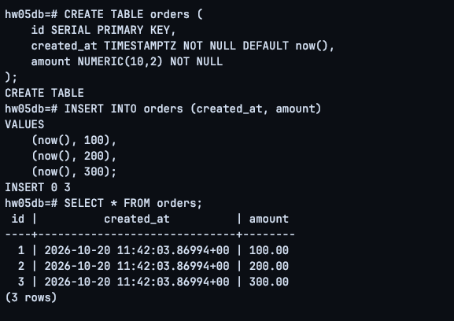
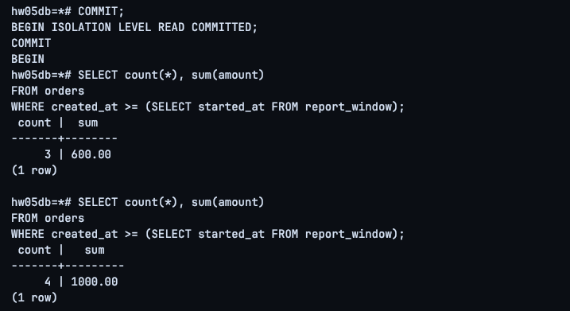
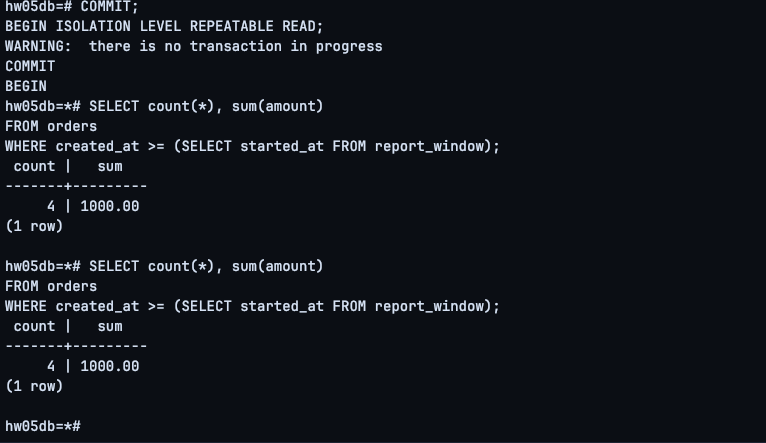
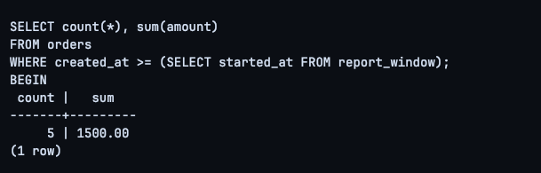

# HW05 — Изоляция транзакций: отчёт по заказам

## Цель

Сравнить `READ COMMITTED` и `REPEATABLE READ` в PostgreSQL 17 при параллельной вставке заказов и выбрать уровень изоляции для согласованного финансового отчёта.

## Стенд и методика

- PostgreSQL 17 в Docker, контейнер `pg17-hw03`.
- Отдельная база `hw05db`.
- Две независимые сессии `psql`: **сессия 1 (Writer)** добавляет заказы, **сессия 2 (Report)** читает показатели.
- В обеих сессиях отключён autocommit: `\set AUTOCOMMIT off`; границы транзакций задавались явно.
- Таблица `orders(id serial primary key, created_at timestamptz, amount numeric(10,2))`.
- Первоначально три заказа на суммы 100, 200, 300.

Для исключения влияния течения времени на результаты эксперимента использовалась таблица `report_window` с **фиксированной нижней границей** `started_at`. Запрос отчёта:

```sql
SELECT count(*) AS orders_count, sum(amount) AS total_amount
FROM orders
WHERE created_at >= (SELECT started_at FROM report_window);
```

Это фиксированное начало отчётного окна, а не непрерывно сдвигающееся окно последних 60 секунд. Такой приём позволяет изолировать эффект уровня транзакционной изоляции. Точные SQL-команды и порядок работы с двумя сессиями приведены в `commands.sql`.

## Подготовка данных

```sql
CREATE TABLE orders (
    id SERIAL PRIMARY KEY,
    created_at TIMESTAMPTZ NOT NULL DEFAULT now(),
    amount NUMERIC(10,2) NOT NULL
);

INSERT INTO orders (created_at, amount)
VALUES (now(), 100), (now(), 200), (now(), 300);
```

Изначально в `orders` находились три строки на сумму **600.00**.



## Таймлайн эксперимента

| № | Сессия | Команда / событие | Результат | Почему |
|---|---|---|---|---|
| 1 | 2 — Report | `BEGIN ISOLATION LEVEL READ COMMITTED;` затем `SELECT count(*), sum(amount)` | **3 / 600.00** | На момент запроса подтверждены три заказа. |
| 2 | 1 — Writer | `BEGIN ... READ COMMITTED; INSERT ... amount=400; COMMIT;` | Новый заказ подтверждён | Коммит делает четвёртый заказ видимым другим транзакциям. |
| 3 | 2 — Report | Повторный `SELECT` в **той же** транзакции | **4 / 1000.00** | `READ COMMITTED` формирует новый снимок для каждого SQL-оператора. |
| 4 | 2 — Report | `COMMIT;` | Транзакция завершена | Переходим к следующему эксперименту. |
| 5 | 2 — Report | `BEGIN ISOLATION LEVEL REPEATABLE READ;` и первый `SELECT` | **4 / 1000.00** | Первый запрос фиксирует снимок данных транзакции. |
| 6 | 1 — Writer | `BEGIN ... REPEATABLE READ; INSERT ... amount=500; COMMIT;` | Пятый заказ подтверждён | Коммит успешен, но уже зафиксированный снимок сессии 2 не меняется. |
| 7 | 2 — Report | Повторный `SELECT` в той же транзакции | **4 / 1000.00** | `REPEATABLE READ` продолжает использовать тот же снимок. |
| 8 | 2 — Report | `COMMIT;` | Транзакция завершена | Старый снимок больше не используется. |
| 9 | 2 — Report | Новая транзакция `REPEATABLE READ` и `SELECT` | **5 / 1500.00** | Новый снимок включает пятый подтверждённый заказ. |

### READ COMMITTED

Первый запрос показал **3 заказа / 600.00**, а повторный в той же транзакции — **4 заказа / 1000.00**.



### REPEATABLE READ

Несмотря на вставку и коммит пятого заказа во второй сессии, оба чтения в одной транзакции Report показали **4 заказа / 1000.00**.



После завершения транзакции новый запрос показал **5 заказов / 1500.00**.



На одном из скриншотов присутствует предупреждение `WARNING: there is no transaction in progress` после `COMMIT`: оно означает, что на тот момент активная транзакция отсутствовала; результат эксперимента это не изменило.

## Сравнение

| Уровень изоляции | До параллельного COMMIT | После COMMIT, в той же транзакции | После завершения и начала новой транзакции |
|---|---:|---:|---:|
| `READ COMMITTED` | 3 / 600.00 | 4 / 1000.00 | — |
| `REPEATABLE READ` | 4 / 1000.00 | 4 / 1000.00 | 5 / 1500.00 |

**Объяснение:** при `READ COMMITTED` каждый оператор видит собственный снимок подтверждённых данных, поэтому агрегаты могут измениться между запросами одной транзакции. При `REPEATABLE READ` PostgreSQL сохраняет один снимок данных для транзакции (с первого запроса, которому он нужен), обеспечивая повторяемость чтения.

## Вывод

Для финансового отчёта, собираемого несколькими запросами в одной транзакции, выбираем **`REPEATABLE READ`**, чтобы количество заказов и их суммы рассчитывались по одному согласованному снимку, несмотря на параллельные вставки. `READ COMMITTED` не гарантирует неизменность агрегатов между последовательными запросами в одной транзакции. После завершения отчётной транзакции следующая транзакция сможет увидеть новые подтверждённые заказы.
