# HW06 — Autovacuum и мёртвые строки PostgreSQL

## Цель и стенд

Проверить, как массовые `UPDATE` влияют на число мёртвых версий строк и физический размер таблицы, сравнить состояние при включённом и выключенном autovacuum и вернуть автоматическое обслуживание после эксперимента.

Эксперимент выполнен **29 октября 2026 года** на VM в UTM (ARM64), Ubuntu **26.04.1 LTS**, PostgreSQL **17.11**, кластер `17/main`, порт `5432`, исходный `autovacuum = on`. По условию стенд должен содержать 2 vCPU, 4 GB RAM, SSD 10 GB. По зафиксированным измерениям VM имела **6 vCPU**, примерно **3.3 GiB доступной гостевой ОС RAM** (при 4 GB, выделенных VM), виртуальный диск **64 GB**, корневую файловую систему **30 GB**. Это **отклонение от требуемых 2 vCPU и 10 GB**, которое могло повлиять на время выполнения и запас свободного места; результаты приведены для фактического стенда.

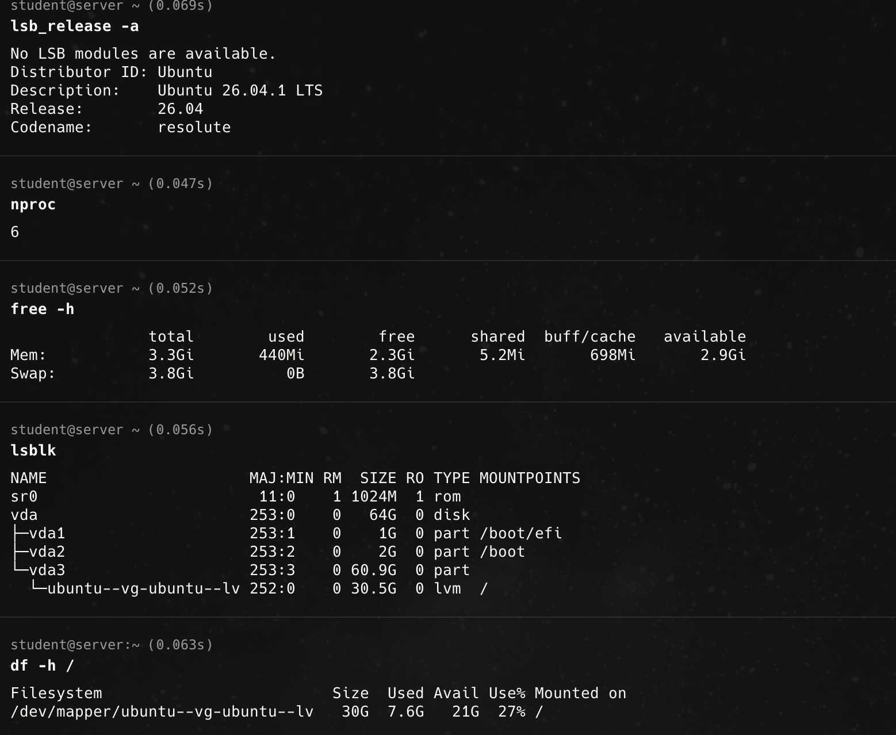

Проверки:

```bash
pg_lsclusters
sudo -u postgres psql -d postgres -c "SHOW autovacuum;"
/usr/lib/postgresql/17/bin/pgbench --version
```

`17 main` — `online`; `autovacuum = on`; `pgbench 17.11`.

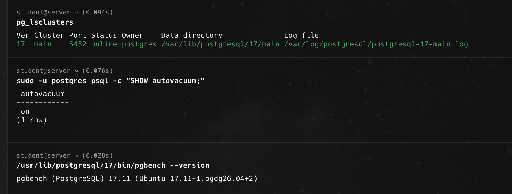

## 1. Нагрузка pgbench и обслуживание после неё

В базе `postgres` выполнена инициализация:

```bash
sudo -u postgres /usr/lib/postgresql/17/bin/pgbench -i postgres
```

Затем 60-секундная нагрузка с 8 клиентами, одним потоком и масштабом по умолчанию `scale = 1`:

```bash
sudo -u postgres /usr/lib/postgresql/17/bin/pgbench -c 8 -P 6 -T 60 -U postgres postgres
```

Реальные результаты: **36 200 транзакций**, **603.443311 TPS**, средняя задержка **13.231 ms**, **0 ошибок**.

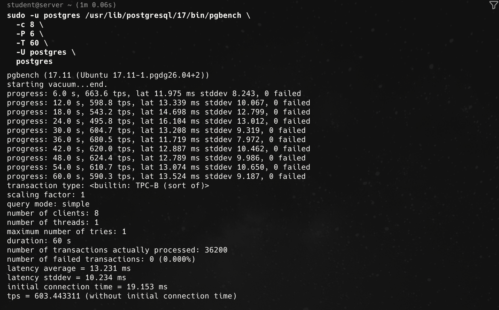

После нагрузки проверены таблицы через `pg_stat_user_tables`:

| Таблица | `n_live_tup` | `n_dead_tup` | `last_autovacuum` (UTC, 29.10.2026) | `last_vacuum` (UTC, 29.10.2026) |
|---|---:|---:|---|---|
| `pgbench_accounts` | 100 000 | 1 894 | 10:31:59 | 10:31:06 |
| `pgbench_branches` | 1 | 0 | 10:32:59 | 10:31:13 |
| `pgbench_history` | 36 200 | 0 | 10:32:04 | 10:31:06 |
| `pgbench_tellers` | 10 | 0 | 10:32:59 | 10:31:13 |

В скриншоте доступны более точные значения времени с долями секунды. Ненулевое `last_vacuum` связано, в том числе, с подготовкой pgbench; последующий `last_autovacuum` подтверждает автоматическое обслуживание.

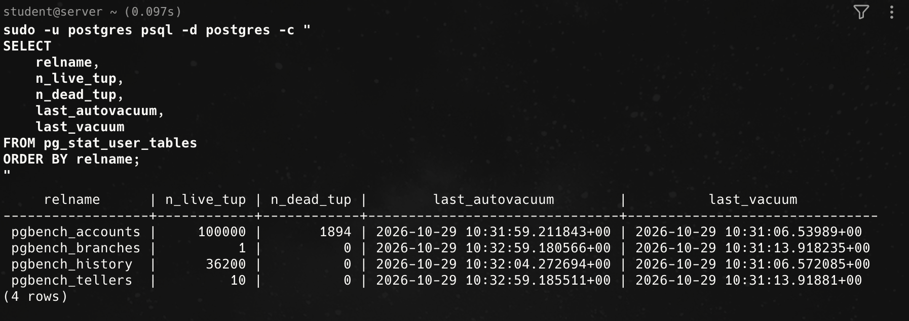

## 2. Эксперимент с `vacuum_test`

Создана таблица с текстовым полем и заполнена **1 000 000 строками**:

```sql
CREATE TABLE vacuum_test (
    id BIGSERIAL PRIMARY KEY,
    description TEXT NOT NULL
);

INSERT INTO vacuum_test (description)
SELECT 'order_' || generate_series(1, 1000000);
```

Измерения выполнялись через `pg_total_relation_size` (данные + индексы + TOAST) и `pg_stat_user_tables` (`n_dead_tup` — **оценка**, не точный подсчёт физических версий).

### Таблица наблюдений

| Шаг | Размер | `n_dead_tup` | `last_autovacuum` (UTC) | `last_vacuum` | Комментарий |
|---|---:|---:|---|---|---|
| 1 млн INSERT | 71 MB | 0 | NULL | NULL | Исходный размер; 1 млн живых строк |
| 1 полный UPDATE | 142 MB | 0 | 10:36:01, 29.10.2026 | NULL | Новые версии увеличили файл; autovacuum уже сработал к моменту замера |
| Всего 5 полных UPDATE | 318 MB | 3 999 844 | 10:36:01, 29.10.2026 | NULL | Накопилось около 4 млн мёртвых версий |
| После autovacuum | 318 MB | 0 | 10:40:10, 29.10.2026 | NULL | Мёртвые версии очищены, но размер файла не уменьшился |
| После 10 UPDATE при `autovacuum_enabled=false` | 790 MB | 10 000 000 | 10:40:10, 29.10.2026 | NULL | Без автоматической очистки накопились новые версии, размер вырос |

В записи `last_autovacuum` показано округлённое до секунд время; точные значения на скриншотах: `2026-10-29 10:36:01.561861+00` и `2026-10-29 10:40:10.189886+00`.

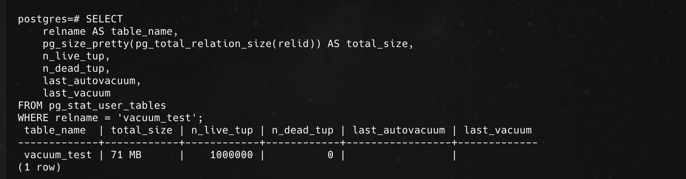
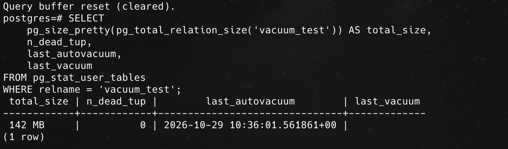

Было выполнено **5 полных обновлений** (первое отдельно, затем ещё четыре):

```sql
UPDATE vacuum_test SET description = description || 'x';
```

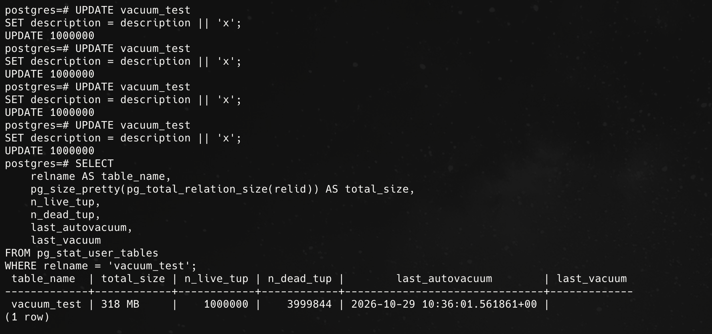

После пяти обновлений `n_dead_tup` достиг `3999844`, а размер — `318 MB`. Наблюдение с обновляющейся статистикой позже зафиксировало `last_autovacuum = 2026-10-29 10:40:10.189886+00` и `n_dead_tup = 0`, при неизменном размере `318 MB`.

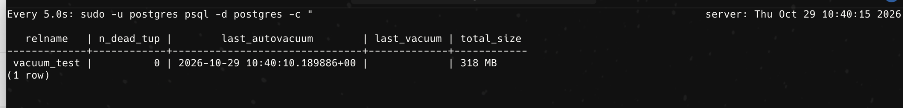

### Отключение autovacuum и 10 обновлений

Автоматическое обслуживание отключалось **только для данной таблицы**:

```sql
ALTER TABLE vacuum_test SET (autovacuum_enabled = false);
SELECT relname, reloptions FROM pg_class
WHERE oid = 'vacuum_test'::regclass;
```

Результат: `{autovacuum_enabled=false}`.

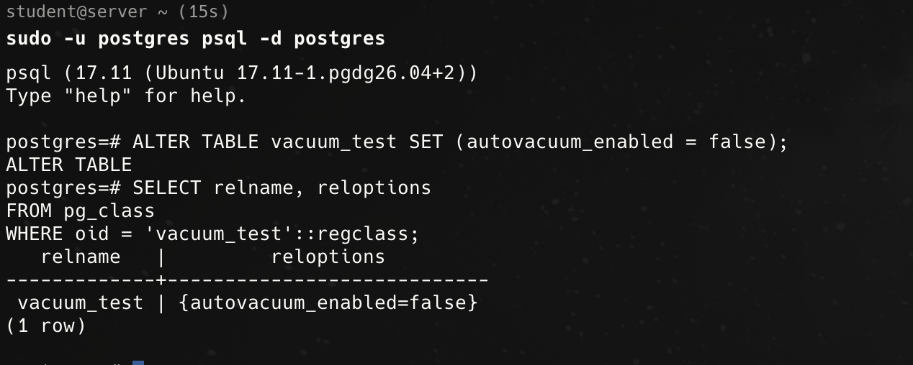

Задание со звёздочкой выполнено анонимным блоком:

```sql
DO $$
DECLARE i integer;
BEGIN
    FOR i IN 1..10 LOOP
        UPDATE vacuum_test SET description = description || 'x';
        RAISE NOTICE 'Итерация % из 10 завершена', i;
    END LOOP;
END;
$$;
```

Получены все сообщения `NOTICE` для итераций 1–10 и результат `DO`. **Все 10 обновлений блока выполнялись в одной транзакции**, в отличие от пяти самостоятельных `UPDATE` до этого: это существенная особенность методики сравнения.

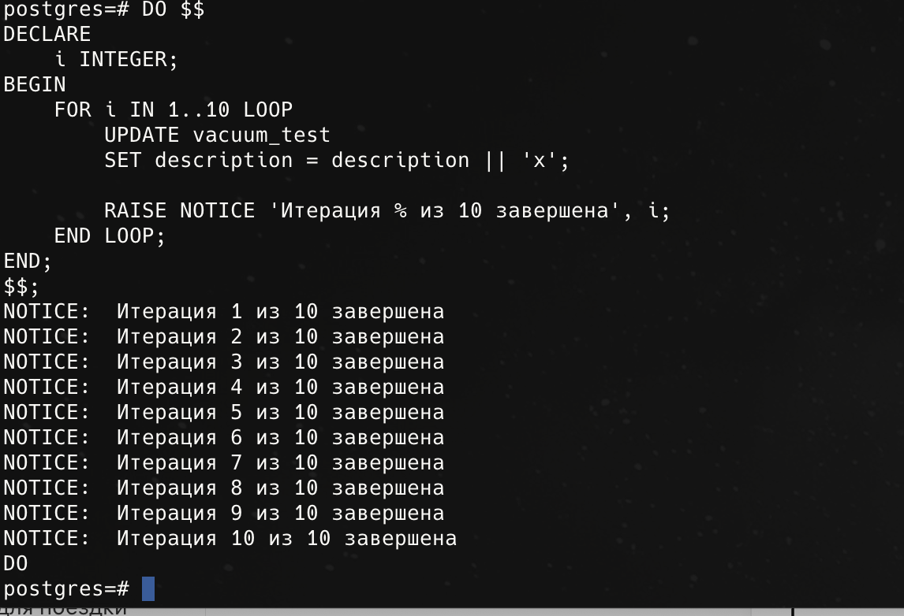

После блока: **790 MB**, `n_dead_tup = 10000000`, `last_autovacuum` осталось на времени предыдущего обслуживания. Доступное место на корневой файловой системе — около **19 GB**.

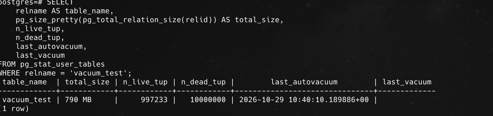
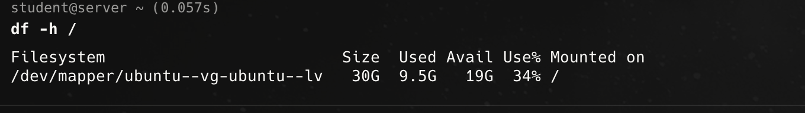

### Возврат исходного режима обслуживания

```sql
ALTER TABLE vacuum_test SET (autovacuum_enabled = true);
SELECT relname, reloptions FROM pg_class
WHERE oid = 'vacuum_test'::regclass;
```

Подтверждение: `{autovacuum_enabled=true}`.

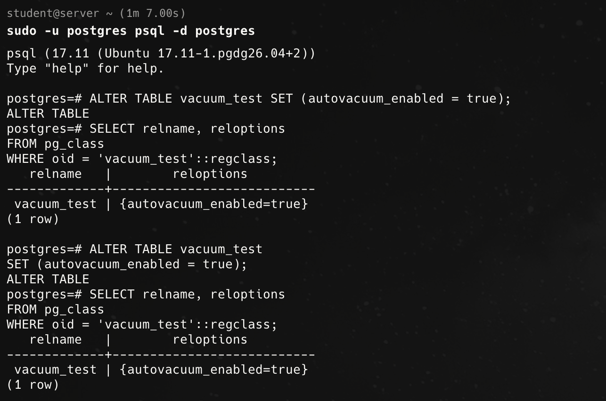

## 3. Объяснение результатов и вывод

При `UPDATE` PostgreSQL в рамках MVCC создаёт новую версию строки, а старая становится кандидатом на удаление, когда перестаёт быть видимой активным транзакциям. Поэтому многократные обновления увеличивают объём занятых страниц и число мёртвых версий. `n_dead_tup` — оценка статистики, которая может изменяться не строго на число фактически созданных версий.

**Autovacuum очищает мёртвые версии и позволяет повторно использовать их пространство, но обычный VACUUM чаще всего не уменьшает физический размер таблицы**. Это видно по переходу `n_dead_tup` от `3999844` к `0` при неизменных `318 MB`. После отключения autovacuum для таблицы `n_dead_tup` вырос до `10000000`, размер — до `790 MB`. Autovacuum возвращён в состояние `on`.

**Вывод:** регулярное обслуживание необходимо для контроля накопления мёртвых версий и повторного использования места. Отключение autovacuum на активно обновляемой таблице приводит к росту числа мёртвых строк и может вызвать разрастание таблицы и индексов. Эксперимент выполнен на тестовой VM; отключение autovacuum не рекомендуется для такого сценария в рабочей системе.
