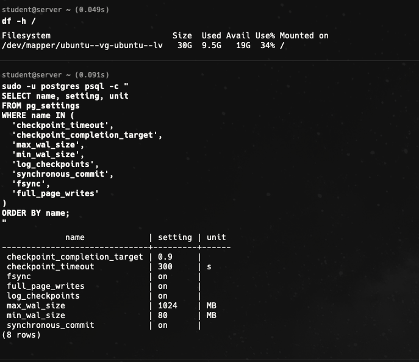
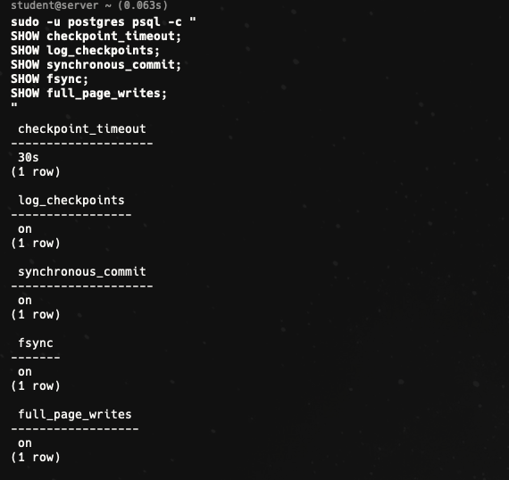
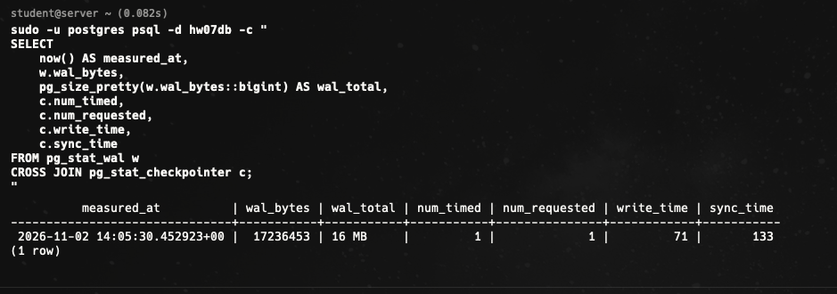
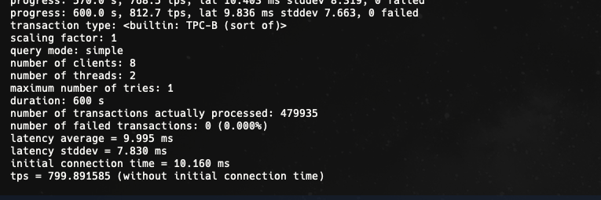
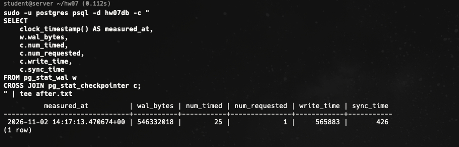
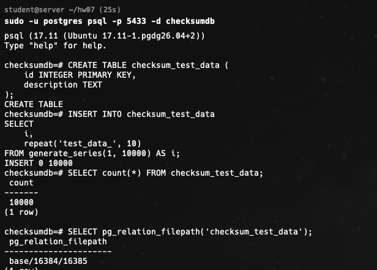
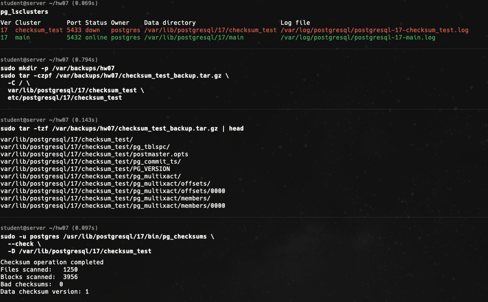
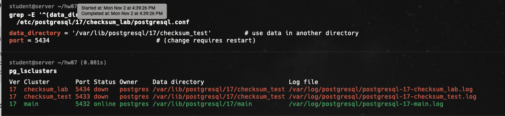

# HW07 — Журналы WAL и контрольные точки PostgreSQL

## Цель и среда

Оценить влияние частых контрольных точек и режима подтверждения транзакций на WAL и производительность. Использовался PostgreSQL **17.11** в Ubuntu VM, база `hw07db`, `pgbench` (scale 1, 8 клиентов, 2 потока, 600 секунд, статистика каждые 30 секунд). Основной кластер — `17/main`, порт 5432.

Настройки основного эксперимента: `checkpoint_timeout = 30s`, `log_checkpoints = on`, `fsync = on`, `full_page_writes = on`. Сравнивались только `synchronous_commit = on` и `off`; остальные параметры оставались неизменными. Точные интервалы снятия статистики немного шире времени нагрузки, особенно при `off`; статистика WAL/checkpointer общая для кластера.





## Подготовка и методика

```bash
sudo -u postgres psql -c "ALTER SYSTEM SET checkpoint_timeout = '30s';"
sudo -u postgres psql -c "ALTER SYSTEM SET log_checkpoints = 'on';"
sudo pg_ctlcluster 17 main reload
sudo -u postgres createdb hw07db
sudo -u postgres /usr/lib/postgresql/17/bin/pgbench -i -s 1 hw07db
```

Для каждого режима снимались накопленные счётчики `pg_stat_wal.wal_bytes`, `pg_stat_checkpointer.num_timed`, `num_requested`, `write_time` и `sync_time` до и после теста. Разница двух показаний — оценка за **интервал между снимками**, а не изолированная статистика самого процесса pgbench.

## Результаты

| Режим | TPS | Средняя latency | Транзакций | WAL между снимками | Checkpoints (timed / requested) | WAL / checkpoint |
|---|---:|---:|---:|---:|---:|---:|
| Sync ON | **799.89** | 9.995 ms | 479 935 | **529 088 849 B (504.57 MiB)** | **21 / 0** | **24.03 MiB** |
| Sync OFF | **1243.171380** | 6.425 ms | 745 900 | **635 608 950 B (606.16 MiB)** | **29 / 0** | **20.90 MiB** |

Ошибок транзакций в обоих прогонах: **0**.

### Снимки счётчиков

| Режим / момент | `wal_bytes` | `num_timed` | `num_requested` | `write_time`, ms | `sync_time`, ms |
|---|---:|---:|---:|---:|---:|
| ON до (14:06:41 UTC) | 17 243 169 | 4 | 1 | 26 735 | 188 |
| ON после | 546 332 018 | 25 | 1 | 565 883 | 426 |
| OFF до (14:19:13 UTC) | 546 341 304 | 29 | 1 | 592 800 | 445 |
| OFF после (14:33:46 UTC) | 1 181 950 254 | 58 | 1 | 1 131 307 | 741 |

Формулы:

```text
WAL_ON  = 546332018 - 17243169   = 529088849 B
CP_ON   = (25-4) + (1-1)          = 21
AVG_ON  = 529088849 / 21          = 25194611.86 B/checkpoint
WAL_OFF = 1181950254 - 546341304 = 635608950 B
CP_OFF  = (58-29) + (1-1)         = 29
AVG_OFF = 635608950 / 29         = 21917550 B/checkpoint
TPS gain = (1243.171380 / 799.89 - 1) * 100 ≈ 55.42%
```

Средний WAL на checkpoint здесь — **арифметическое отношение прироста WAL к числу завершённых checkpoints в интервале**, а не прямое измерение WAL каждой checkpoint. Интервал `OFF` между снимками составил около **14 мин 32 с**, хотя сама нагрузка шла 10 мин, поэтому количество checkpoint и WAL в `OFF` нельзя напрямую трактовать как строго за 600 секунд теста.







Вывод `pgbench` асинхронного теста зафиксирован из терминала: **1243.171380 TPS**, 745 900 транзакций, latency 6.425 ms, 0 ошибок.

## Анализ логов контрольных точек

В `checkpoint_logs.txt` содержатся строки `checkpoint starting: time` и `checkpoint complete`. Например, по логу от 2026-11-02:

```text
14:15:05.067 UTC  checkpoint starting: time
14:15:32.025 UTC  checkpoint complete: ... total=26.955 s
14:15:35.028 UTC  checkpoint starting: time
14:16:02.112 UTC  checkpoint complete: ... total=27.085 s
```

Запуски срабатывали приблизительно через **30 секунд**, но завершение приходилось почти на 27 секунд позднее начала. Это объясняется растянутой во времени записью грязных страниц (в том числе действием `checkpoint_completion_target = 0.9`). В логах за 2026-10-29 также есть контрольные точки `starting: wal`, то есть инициированные объёмом WAL, но они относятся к **другому периоду**, не к измерению 2026-11-02. В рамках синхронного теста прирост `num_requested = 0`.

## Объяснение разницы режимов и рекомендация

При `synchronous_commit = on` клиент получает подтверждение коммита после необходимого сброса WAL. При `off` подтверждение может поступить раньше: на этом стенде TPS вырос примерно на **55.4%**, а средняя latency снизилась приблизительно на **35.7%**. `off` не отключает WAL, `fsync` и `full_page_writes` по-прежнему работали.

Для покупки и оплаты билетов рекомендован **`synchronous_commit = on`**, потому что потенциальная потеря последних уже подтверждённых заказов после аварии противоречит требованиям финансового учёта. Более высокую нагрузку следует обеспечивать оптимизацией I/O и запросов, настройкой WAL/checkpoints, управлением соединениями и архитектурой репликации, не отключая гарантии подтверждённых операций.

После измерений были возвращены настройки: `synchronous_commit = on`, `checkpoint_timeout = 5min`, `fsync = on`, `full_page_writes = on`.

---

## ⭐ Эксперимент с контрольными суммами страниц

Создан отдельный кластер PostgreSQL 17 `checksum_test` на порту 5433 с `--data-checksums`. В базе `checksumdb` создана таблица `checksum_test_data` и вставлено **10 000 строк**. Файл таблицы: `base/16384/16385`.



Основной кластер `main` продолжал работать отдельно. Кластер `checksum_test` был остановлен и архивирован. `pg_checksums --check` до эксперимента показал **3956 проверенных блоков, 0 ошибок, checksum version 1**.



Создана независимая остановленная копия `checksum_lab` с отдельными `data_directory` и портом 5434; исходный кластер не модифицировался. Перед повреждением проверка копии: **Bad checksums: 0**.



В отключённой копии изменён один байт второй 8-KiB страницы файла `base/16384/16385` (блок 1). Проверка обнаружила:

```text
pg_checksums: error: checksum verification failed in file ".../base/16384/16385", block 1: calculated checksum DB41 but block contains BA69
Files scanned: 1250
Blocks scanned: 3956
Bad checksums: 1
Data checksum version: 1
```

После запуска лабораторного кластера чтение `SELECT count(*) FROM checksum_test_data;` завершилось:

```text
WARNING: page verification failed, calculated checksum 56129 but expected 47721
ERROR: invalid page in block 1 of relation base/16384/16385
```

Затем лабораторный кластер остановили, а изменённый файл заменили резервной копией, сделанной непосредственно перед экспериментом. Повторный `pg_checksums --check` сообщил:

```text
Checksum operation completed
Files scanned: 1250
Blocks scanned: 3965
Bad checksums: 0
Data checksum version: 1
```

**Ограничение результата:** отсутствие плохих checksums после восстановления подтверждено, однако **успешный повторный запуск `checksum_lab` и `SELECT count(*) = 10000` не подтверждены**: при последней попытке кластер не стартовал, причина не установлена. Поэтому демонстрация обнаружения повреждения завершена, а проверка полноценного восстановления остаётся открытой.

### Безопасные действия при аварийном повреждении

1. Остановить запись и сохранить диагностические журналы; проверить хранилище и масштаб повреждений.
2. Восстанавливать согласованный кластер из проверенной физической резервной копии, при наличии WAL — выполнить point-in-time recovery; при необходимости извлекать уцелевшие данные из копии, а не из рабочего оригинала.
3. Проверить целостность и работоспособность восстановленного экземпляра, выполнить SQL-контроль данных и лишь затем переключать приложение.

Простая подмена физического файла таблицы обычно **не является** безопасным универсальным способом восстановления production-системы; в этом эксперименте она была допустима только из-за остановленного кластера, немедленно сохранённой лабораторной копии и отсутствия последующих изменений.

## Вывод

Частые checkpoint создают заметную регулярную нагрузку на запись; длительность их выполнения отличается от интервала запуска. Асинхронный коммит увеличил TPS на ~55%, но ценой риска потери последних подтверждённых транзакций при аварии. Для финансовых операций выбран синхронный commit. Checksums успешно обнаружили повреждённую страницу; после возврата файла повторная проверка целостности прошла, но финальный старт лабораторного кластера ещё требует диагностики.
